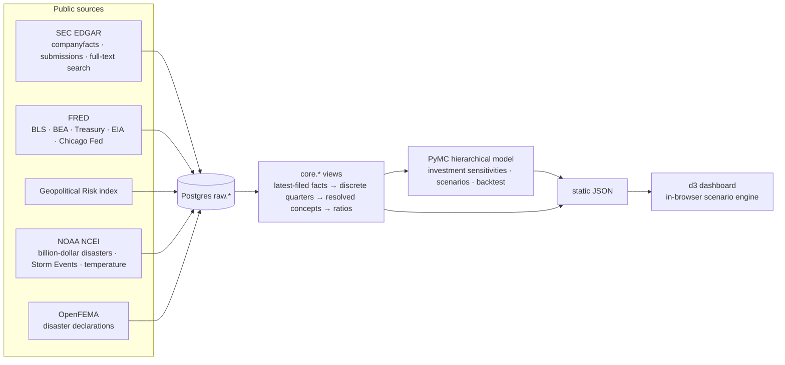

# Specialty Insurance Stress Lab

**Live dashboard: https://willboyden.github.io/specialty-insurance-lab/**

47 hand-selected US-listed specialty insurers, including the ones acquired or delisted since 2009, rebuilt quarter
by quarter from public SEC filings; set against catastrophe, geopolitical, AI-cycle and inflation data; and
stress-tested with a hierarchical Bayesian model whose scenarios run live in the browser.


## What is in it

- **A Postgres database of public data** (about 1.6 million rows): every us-gaap, dei and srt XBRL fact reported by
  56 insurers in any SEC filing (each filing's version kept), five capex and cash-flow tags of six
  AI-infrastructure companies, the full EDGAR filing index, SEC full-text search hits for 17 risk themes, 27 FRED
  series, the Caldara-Iacoviello Geopolitical Risk index, NOAA catastrophe and temperature data and every FEMA
  disaster declaration. Schema: [docs/schema.md](docs/schema.md).
- **A standardization layer** that turns raw XBRL into comparable quarterly underwriting ratios (loss,
  accident-year loss, reserve development, expense, combined), with the tag behind every number and a quality
  flag where a fallback was needed.
- **A hierarchical Bayesian loss-ratio model** (PyMC) with partial pooling by segment, a latent industry shock
  that turns out to be the catastrophe calendar, and catastrophe-adjusted persistence. Plus empirical-Bayes
  estimates of each portfolio's reinvestment speed and of book-value sensitivity to rates and financial conditions.
- **Five stress scenarios** (an AI-led equity unwind, geopolitical escalation, climate-driven catastrophe years,
  a social-inflation surge, and all four at once) with a severity control. The shocks, and the overlays used where
  history cannot identify a channel, are assumptions; how each carrier responds to the shocks is estimated. The
  simulator runs in the browser and matches the Python reference to 1e-9 on the exported inputs (checked in CI).
- **A rolling-origin backtest** from 2017 to 2024 against naive forecasts.
- **A d3 dashboard** with linked views: hover a carrier anywhere and it lights up everywhere; every chart has an
  accessible table view, light and dark themes, and works on a phone.

## Findings

<!-- findings:start -->
### Universe

- 47 specialty carriers (24 active, 23 acquired or exited), 9 standard-lines benchmark carriers (4 flagged not comparable).
- 1,089,511 XBRL facts (3,737 distinct tags), 76,265 filings in the insurers' EDGAR indexes.

### The industry (catastrophe) shock

Largest quarters of the latent shock the model infers from loss ratios alone: Q3 2017 (+5.1 sd), Q1 2011 (+2.7 sd), Q4 2018 (+2.0 sd), Q4 2012 (+1.5 sd), Q3 2021 (+1.4 sd), Q3 2020 (+1.4 sd).
No catastrophe data goes into the model, yet the shock correlates 0.58 with log NOAA Storm Events property damage (67 quarters) and 0.43 with log NOAA billion-dollar disaster costs (60 quarters, through 2024).

### Catastrophe sensitivity (loss-ratio points per 1 sd of the industry shock)

- Highest: RNR 32.4, PLGO 26.2, VR 22.2, HG 17.5, ENH 14.4
- Lowest: PGR 0.7, AFSI 0.7, PRA 0.7, EIG 0.6, AMSF 0.4

### Premium growth, same company, trailing four quarters to Q3 2026

- E&S and specialty commercial: 19.7%
- Diversified specialty: 2.6%
- Bermuda and international specialty (re)insurance: -4.2%
- Standard-lines benchmark: 4.8%
- Median active specialty carrier: 4.4%

### Reserve development (specialty, premium-weighted, TTM)

- Favorable in 63 of 63 quarters.
- Fiscal-year average since 2011: −2.9 pts; average of the last 12 quarters: −1.5 pts.

### The standard-lines benchmark

Premium weights at Q3 2026: PGR 57%, TRV 29%, CINF 7%, THG 4%, SIGI 3%.

### Hyperscaler capex (total capital expenditure of Microsoft, Alphabet, Amazon, Meta, from their filings)

- Q3 2026: $202B in the quarter, +108% year over year, 91% of their operating cash flow (trailing four quarters).

### Backtest (rolling origins 2017–2024, 1,524 forecasts, 37 carriers)

- Year-1 loss ratio, mean absolute error: model 5.16 pts, with realized drivers 5.43, last four quarters 5.26, company average 5.64.
- Year-2: model 6.26, with realized drivers 6.61, last four quarters 6.55, company average 6.07.
- 80% interval coverage by horizon: h1 87%, h2 85%, h3 83%, h4 69%, h5 86%, h6 86%, h7 87%, h8 74%
- The gains are modest and fade: in year 2 a carrier's own long-run average forecasts as well or better.

### Stress scenarios at severity 1

Median year-1 combined-ratio change vs the baseline, and capital generated over eight quarters vs the baseline. Where a scenario carries an assumption overlay, the part of the change that the overlay contributes is shown separately.

- **AI equity unwind**: biggest combined-ratio hits TRV +3.0 pts (overlay +0.2 pts), ACGL +2.9 pts (overlay +0.3 pts), THG +2.7 pts (overlay +0.2 pts), CINF +2.7 pts (overlay +0.1 pts); biggest capital hits MKL −23 pts of equity, RLI −20 pts of equity, KNSL −15 pts of equity.
- **Geopolitical escalation**: biggest combined-ratio hits AXS +3.6 pts (overlay +2.1 pts), EG +3.3 pts (overlay +1.5 pts), HG +3.3 pts (overlay +1.8 pts), RNR +2.8 pts (overlay +1.5 pts); biggest capital hits MKL −10 pts of equity, RLI −9 pts of equity, SIGI −7 pts of equity.
- **Climate-driven catastrophe years**: biggest combined-ratio hits RNR +31.8 pts, PLGO +25.7 pts, HG +17.4 pts, EG +13.5 pts; biggest capital hits PLGO −53 pts of equity, RNR −36 pts of equity, HG −26 pts of equity.
- **Social-inflation surge**: biggest combined-ratio hits PRA +4.6 pts (overlay +4.2 pts), RNR +3.4 pts (overlay +3.0 pts), PRHI +3.2 pts (overlay +3.0 pts), EIG +3.1 pts (overlay +2.8 pts); biggest capital hits JRVR −17 pts of equity, AMSF −15 pts of equity, BOW −12 pts of equity.
- **Everything at once**: biggest combined-ratio hits RNR +41.0 pts (overlay +4.8 pts), PLGO +31.0 pts (overlay +0.9 pts), HG +25.9 pts (overlay +4.3 pts), EG +19.6 pts (overlay +1.9 pts); biggest capital hits PLGO −62 pts of equity, RNR −56 pts of equity, MKL −41 pts of equity.

### Model diagnostics

- 462 parameters checked: max R-hat 1.005, minimum bulk ESS 849, 0 divergences; sampling took 35 s.
<!-- findings:end -->

All numbers above are recomputed from the data by [`scripts/findings.py`](scripts/findings.py); the full list is
in [docs/findings.md](docs/findings.md).

## How it works



1. **Ingest** (`sil/sources/`): a polite, caching HTTP client (SEC asks for at most 10 requests a second) loads
   each source into its own `raw.*` table. Every filing's version of every fact is kept, so restated numbers
   never overwrite what was first reported.
2. **Standardize** (`db/views/010_core_facts.sql`, `sil/standardize.py`): the most recently filed value per
   period; discrete quarters from reported three-month values or year-to-date differences (Q4 = full year minus
   nine months); each insurance concept resolved from a ranked list of XBRL tags, where a fallback must also pass
   a plausibility check against premiums (one filer's partial loss tag covers 5% of its premium; another tags
   acquisition costs with the wrong sign).
3. **Model** (`sil/model/`): see below.
4. **Export** (`sil/export.py`): compact JSON for the static site, from an allowlist of public drivers.

### The loss-ratio model

```
LR[i,t] = mu[i](1 - rho[i]) + rho[i] * A[i,t-1] + sum_k beta[i,k] x[k,t] + lam[i] f[t] + e[i,t],   e ~ Student-t(5)
A[i,t-1] = mean of the previous four (LR - lam[i] f)          (catastrophe-adjusted, so catastrophes do not persist)
```

`mu` (long-run loss ratio), `rho` (persistence), `beta` (sensitivity to litigation-cost inflation, geopolitical
shocks and financial stress) and `lam` (catastrophe sensitivity) are drawn around segment means (partial pooling,
non-centered). The segment means of `beta` have a non-negative (half-normal) prior: those drivers should not lower
loss ratios on average. `f` is a zero-sum latent industry shock, estimated from the carriers' loss ratios alone;
its largest quarters are the big catastrophe quarters. Three candidate drivers were tested and dropped: a public
catastrophe index (the latent shock tracks insured catastrophes better), lagged insurance pricing and general CPI
inflation. The last two are confounded by the pricing cycle (prices chase loss trends; 2022-23 inflation coincided
with a hard reinsurance market), which the model does not represent, so the scenarios carry no general-inflation
channel.

The investment side is estimated per company with empirical-Bayes shrinkage: how fast each portfolio's yield
follows the 5-year Treasury, and how other comprehensive income responds to changes in rates and in the Chicago
Fed NFCI. For the NFCI term the company estimates are no more spread out than their noise, so the shrinkage pools
them completely into one value.

### Scenarios


Each scenario is a set of quarterly shock paths in natural units (equity returns, the 5-year Treasury, the Chicago
Fed NFCI, litigation-cost inflation, the Geopolitical Risk index, premium growth, the industry shock),
calibrated to historical episodes (for example, the NFCI peak of the AI unwind is the size of the 2020 rise) and
scaled by the severity setting. Where 2010-2026 data cannot identify a channel, an explicit, exposure-weighted
overlay is added and labeled as an assumption: event losses on political-risk, war and trade-credit books;
professional-lines claims after a market bust; reserve strengthening under social inflation. Exposures come from how
often each carrier's own filings discuss those lines (reserve strengthening scales with reserves per dollar of
premium). The findings above show how much of each hit comes from an overlay. The baseline equity return is an
assumption too: 2% a quarter with 8% quarterly volatility.

## Reproduce it

Requirements: Docker, [uv](https://docs.astral.sh/uv/), Node 22.

```bash
scripts/init-env.sh                       # random database password in .env (mode 600, gitignored)
docker compose up -d                      # Postgres 17 on 127.0.0.1:5544
uv sync                                   # Python 3.13 environment (dependencies at least 14 days old)
uv run python -m sil migrate
uv run python -m sil ingest               # SEC, full-text search, FRED, GPR, FEMA, NOAA (about 5 minutes)
uv run python -m sil export               # standardize, fit, simulate, write dashboard/public/data
uv run python -m sil.model.backtest       # rolling-origin backtest -> backtest.json
uv run python -m scripts.findings         # recompute the findings above
cd dashboard && npm ci && npm test && npm run dev
```

**Access notes.** SEC's fair-access policy asks automated clients to declare who they are in the User-Agent; set
`SIL_USER_AGENT="Your Name your@email"` before ingesting. With the default generic name only `data.sec.gov` and
`efts.sec.gov` are used (filing documents on `www.sec.gov` are not downloaded). FRED series are read from the public
`fredgraph.csv` download (no API key) and their titles from the series pages.

## Limitations

- The universe is hand-selected by the rules in [`sil/universe.py`](sil/universe.py) from the candidate list in
  [docs/universe_candidates.tsv](docs/universe_candidates.tsv); it is not a census. Pure property-catastrophe and
  life or casualty reinsurers are left out.
- Figures are consolidated: a group's ratios include all of its business. Four benchmark groups whose premium and
  loss lines mix in life, group-benefit or long-term-care business are flagged and kept out of the model. The
  premium-weighted benchmark is dominated by its two largest members.
- Expense ratios are rebuilt from XBRL tags, the annual Schedule III, or the income statement; for some carriers
  they differ from company-reported ratios by a few points. Each quarter records which source was used.
- Macro sensitivities are small and pooled within segments; the AI unwind's loss-ratio effect rests on a
  financial-stress loading identified mostly by the 2020 shock.
- The backtest gains are modest (a few percent in year 1; in year 2 a carrier's own average does as well or
  better). The driver set was chosen with the full sample in view, the backtest uses the latest filed values rather
  than values as first reported, and its refits use fewer posterior draws than the production fit.
- No market prices: free sources need a key or a browser, and index owners restrict redistribution.
- Disclosure counts measure what filings discuss, not exposure.
- Scenarios are hypothetical stress tests, not predictions, and nothing here is investment advice.

## Repository layout

```
sil/               Python package: sources/, standardize.py, drivers.py, model/, export.py, cli.py
db/                migrations/ (schema) and views/ (the SQL core layer)
scripts/           init-env.sh, findings.py, schema_doc.py, discover_universe.py, make_engine_fixture.py
tests/             Python unit tests (no database or network needed)
dashboard/         Vite + TypeScript + d3: src/ (sections, charts, engine.ts), tests/, public/data/
docs/              schema.md, findings.md, universe_candidates.tsv, screenshots
```

## Data sources and terms

- **SEC EDGAR** (U.S. Securities and Exchange Commission): XBRL company facts, submissions and full-text search.
  Public domain.
- **FRED**, Federal Reserve Bank of St. Louis: series from the U.S. Bureau of Labor Statistics (CPI, producer
  prices), Bureau of Economic Analysis (GDP), U.S. Treasury (yields), Energy Information Administration (Brent),
  Census Bureau (construction), Federal Reserve Bank of Chicago (NFCI) and the NBER-based recession indicator.
- **Geopolitical Risk index**: Caldara, Dario and Matteo Iacoviello (2022), "Measuring Geopolitical Risk",
  *American Economic Review* 112(4), 1194-1225; data from matteoiacoviello.com.
- **Economic Policy Uncertainty index**: Baker, Scott R., Nicholas Bloom and Steven J. Davis (2016), "Measuring
  Economic Policy Uncertainty", *Quarterly Journal of Economics* 131(4), 1593-1636; via FRED.
- **NOAA National Centers for Environmental Information**: U.S. Billion-Dollar Weather and Climate Disasters
  (1980-2024), Storm Events Database, Climate at a Glance global temperature.
- **OpenFEMA**: Disaster Declarations Summaries. FEMA's terms: this product uses the FEMA OpenFEMA API but is not
  endorsed by FEMA.

Code under the MIT license.
