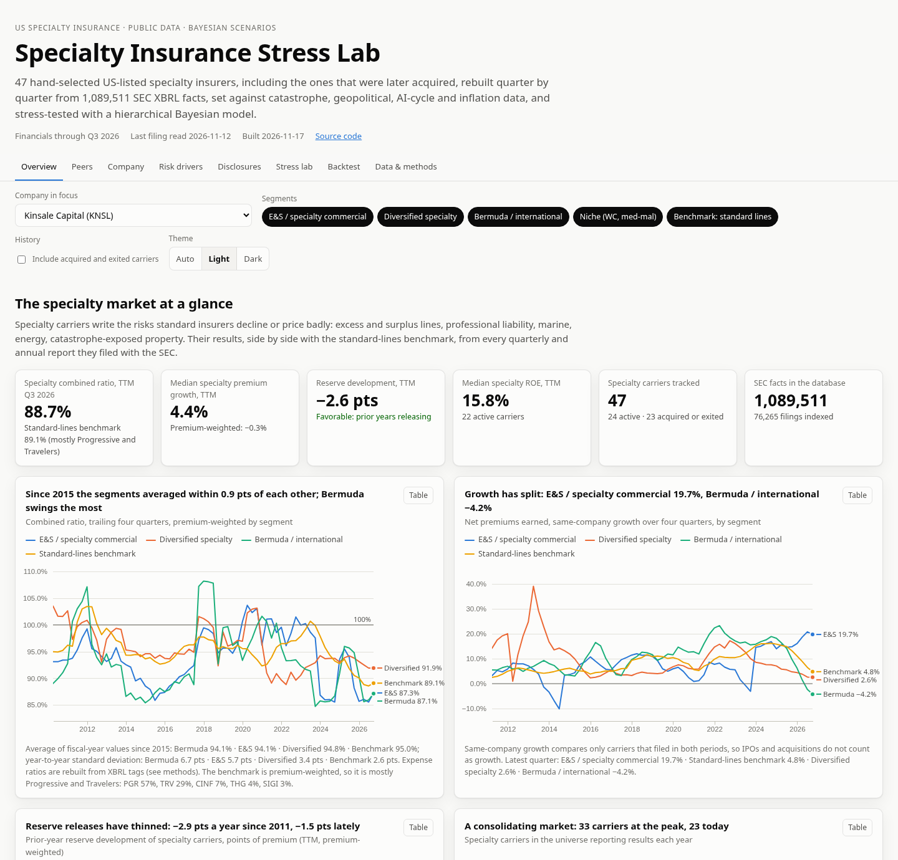
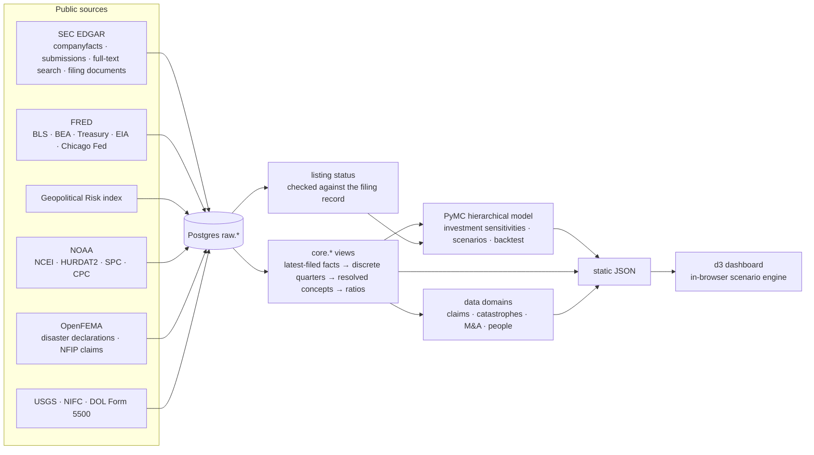
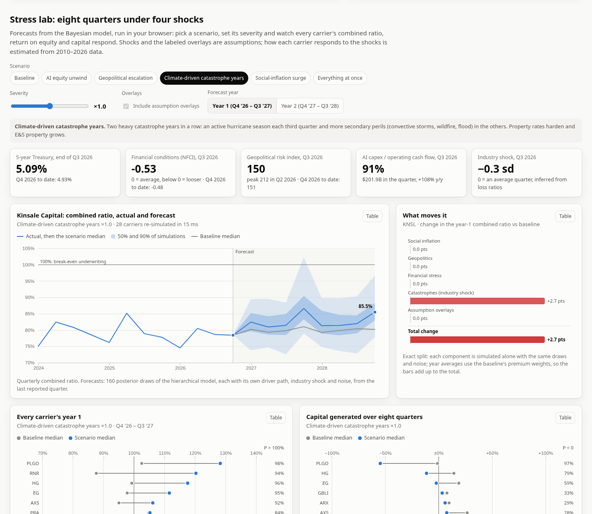

# Specialty Insurance Stress Lab

**Live dashboard: https://willboyden.github.io/specialty-insurance-lab/**

47 hand-selected US-listed specialty insurers, including the ones acquired or delisted since 2009, rebuilt quarter
by quarter from public SEC filings; set against catastrophe, geopolitical, AI-cycle and inflation data; and
stress-tested with a hierarchical Bayesian model whose scenarios run live in the browser. Around the model: each
carrier's claims and reserves, the catastrophes behind the industry's bad quarters, every acquisition in the
universe, and how many people the carriers employ and what they say about technology.



## What is in it

- **A Postgres database of public data** (about 1.8 million rows in 60 tables): every us-gaap, dei and srt XBRL fact
  reported by 56 insurers in any SEC filing (each filing's version kept), five capex and cash-flow tags of six
  AI-infrastructure companies, the full EDGAR filing index, SEC full-text search hits for 17 risk themes and 8
  technology themes, FRED series, the Caldara-Iacoviello Geopolitical Risk index, NOAA catastrophe, hurricane,
  severe-storm, ENSO and temperature data, USGS earthquakes, NIFC wildfire statistics, every FEMA disaster
  declaration and 1.7 million NFIP flood claims (aggregated), and Department of Labor Form 5500 retirement-plan
  filings. Schema: [docs/schema.md](docs/schema.md).
- **Company status checked against the filing record** at every build ([`sil/status.py`](sil/status.py)): the build
  stops if a hand-written label (active, acquired, stopped filing) contradicts the SEC record, and pending deals are
  flagged from merger proxies, going-private schedules and tender offers.
- **A standardization layer** that turns raw XBRL into comparable quarterly underwriting ratios (loss,
  accident-year loss, reserve development, expense, combined), with the tag behind every number and a quality
  flag where a fallback was needed.
- **A hierarchical Bayesian loss-ratio model** (PyMC) with partial pooling by segment, a latent industry shock
  that turns out to be the catastrophe calendar, and catastrophe-adjusted persistence. Plus empirical-Bayes
  estimates of each portfolio's reinvestment speed and of book-value sensitivity to rates and financial conditions.
- **Five stress scenarios** (an AI-led equity unwind, geopolitical escalation, climate-driven catastrophe years,
  a social-inflation surge, and all four at once) with a severity control. The shocks, and the overlays used where
  history cannot identify a channel, are assumptions; how each carrier responds to the shocks is estimated. The
  simulator runs in the browser and matches the Python reference to 1e-9 on the exported inputs (checked in CI).
- **A rolling-origin backtest** from 2017 to 2024 against naive forecasts.
- **Four data domains** ([`sil/domains.py`](sil/domains.py), method notes in [docs/domains/](docs/domains/)):
  - *Claims and reserves*: every carrier's reserve roll-forward by year: paid against incurred, prior-year
    development as a share of opening reserves, years of paid claims held in reserve, reserves against equity,
    reinsurance share.
  - *Catastrophes*: US hurricane landfalls and season energy, convective-storm reports, NFIP flood claims,
    wildfire, earthquakes and ENSO, measured against the model's industry shock; each carrier's estimated
    catastrophe sensitivity.
  - *Mergers and acquisitions*: 25 deals (23 closed, 2 pending), with buyer, price and form of payment each verified
    by exact-phrase search of the targets' own filings; deal values, price-to-book against the target's
    profitability, consolidation of the listed universe, acquisition spending and goodwill.
  - *People and technology*: US staff from Form 5500 retirement-plan filings, premium per employee, staff growth
    against premium growth, capital spending, technology themes in filings, industry employment and the AI
    builders' R&D.
  - Parts that need SEC filing documents (accident-year triangles and claim counts from the 10-K XBRL instances,
    company-reported catastrophe losses from earnings releases, headcount as reported in each 10-K, deal terms
    read from merger proxies) are built and tested, and switch on once the documents are downloaded (see Access
    notes).
- **A d3 dashboard** with linked views: hover a carrier anywhere and it lights up everywhere; every chart has an
  accessible table view, light and dark themes, and works on a phone.

## Findings

<!-- findings:start -->
### Universe

- 47 specialty carriers (23 active, 24 acquired or exited), 9 standard-lines benchmark carriers (4 flagged not comparable).
- 1,089,511 XBRL facts (3,737 distinct tags), 76,265 filings in the insurers' EDGAR indexes.

### The industry (catastrophe) shock

Largest quarters of the latent shock the model infers from loss ratios alone: Q3 2017 (+5.1 sd), Q1 2011 (+2.7 sd), Q4 2018 (+2.0 sd), Q4 2012 (+1.5 sd), Q3 2021 (+1.4 sd), Q3 2020 (+1.4 sd).
No catastrophe data goes into the model, yet the shock correlates 0.58 with log NOAA Storm Events property damage (67 quarters) and 0.43 with log NOAA billion-dollar disaster costs (60 quarters, through 2024).

### Catastrophe sensitivity (loss-ratio points per 1 sd of the industry shock)

- Highest: RNR 32.4, PLGO 26.2, VR 22.2, HG 17.5, ENH 14.4
- Lowest: PGR 0.7, AFSI 0.7, PRA 0.7, EIG 0.6, AMSF 0.4

### Premium growth, same company, trailing four quarters to Q3 2026

- E&S and specialty commercial: 19.7%
- Diversified specialty: 2.6%
- Bermuda and international specialty (re)insurance: -4.2%
- Standard-lines benchmark: 4.8%
- Median active specialty carrier: 4.4%

### Reserve development (specialty, premium-weighted, TTM)

- Favorable in 63 of 63 quarters.
- Fiscal-year average since 2011: −2.9 pts; average of the last 12 quarters: −1.5 pts.

### The standard-lines benchmark

Premium weights at Q3 2026: PGR 57%, TRV 29%, CINF 7%, THG 4%, SIGI 3%.

### Hyperscaler capex (total capital expenditure of Microsoft, Alphabet, Amazon, Meta, from their filings)

- Q3 2026: $202B in the quarter, +108% year over year, 91% of their operating cash flow (trailing four quarters).

### Backtest (rolling origins 2017–2024, 1,524 forecasts, 37 carriers)

- Year-1 loss ratio, mean absolute error: model 5.16 pts, with realized drivers 5.43, last four quarters 5.26, company average 5.64.
- Year-2: model 6.26, with realized drivers 6.61, last four quarters 6.55, company average 6.07.
- 80% interval coverage by horizon: h1 87%, h2 85%, h3 83%, h4 69%, h5 86%, h6 86%, h7 87%, h8 74%
- The gains are modest and fade: in year 2 a carrier's own long-run average forecasts as well or better.

### Stress scenarios at severity 1

Median year-1 combined-ratio change vs the baseline, and capital generated over eight quarters vs the baseline. Where a scenario carries an assumption overlay, the part of the change that the overlay contributes is shown separately.

- **AI equity unwind**: biggest combined-ratio hits TRV +3.0 pts (overlay +0.2 pts), ACGL +2.9 pts (overlay +0.3 pts), THG +2.7 pts (overlay +0.2 pts), CINF +2.7 pts (overlay +0.1 pts); biggest capital hits MKL −23 pts of equity, RLI −20 pts of equity, KNSL −14 pts of equity.
- **Geopolitical escalation**: biggest combined-ratio hits HG +3.6 pts (overlay +1.9 pts), AXS +3.4 pts (overlay +2.1 pts), EG +3.3 pts (overlay +1.5 pts), RNR +2.8 pts (overlay +1.5 pts); biggest capital hits MKL −10 pts of equity, RLI −9 pts of equity, SIGI −7 pts of equity.
- **Climate-driven catastrophe years**: biggest combined-ratio hits RNR +31.8 pts, PLGO +25.9 pts, HG +17.6 pts, EG +13.5 pts; biggest capital hits PLGO −53 pts of equity, RNR −36 pts of equity, HG −25 pts of equity.
- **Social-inflation surge**: biggest combined-ratio hits RNR +3.4 pts (overlay +3.0 pts), PRHI +3.2 pts (overlay +3.0 pts), EIG +3.1 pts (overlay +2.8 pts), MKL +3.0 pts (overlay +2.8 pts); biggest capital hits JRVR −19 pts of equity, AMSF −15 pts of equity, BOW −12 pts of equity.
- **Everything at once**: biggest combined-ratio hits RNR +41.0 pts (overlay +4.8 pts), PLGO +31.3 pts (overlay +0.9 pts), HG +25.8 pts (overlay +4.2 pts), EG +19.6 pts (overlay +1.9 pts); biggest capital hits PLGO −59 pts of equity, RNR −56 pts of equity, MKL −41 pts of equity.

### Claims and reserves (56 carriers, fiscal 2009–2025)

- Median prior-year reserve development of comparable specialty carriers, as a share of opening reserves (negative = releases): 2010–2017 −1.9% (71 of 238 carriers adverse); 2023–2024 0.0% (23 of 50 carriers adverse); 2025 −2.2% (6 of 25 carriers adverse).
- Longest tails in fiscal 2025 (years of paid claims held in reserve): Bowhead Specialty 8.3 yrs (paid 27% of incurred), Kinsale Capital 7.3 yrs (paid 39% of incurred), Hamilton Insurance 4.8 yrs (paid 50% of incurred); specialty median 2.9 yrs.
- Premium growth and paid-to-incurred across 27 active carriers, fiscal 2025: correlation -0.76 (new business is incurred at once and paid over years).
- Largest single-year reserve charges: Atlas Financial 2018 (55.0% of opening reserves), Tower Group 2013 (37.5% of opening reserves), Presurance (Conifer) 2016 (34.1% of opening reserves).

### Catastrophes

- US perils explain 40% of the model's industry shock in sample (adjusted 36%) and 18% out of sample (64 quarters, Q1 2010–Q4 2025).
- The largest miss is Q1 2011: shock +2.74 sd, US perils predict -0.28 sd (carriers write worldwide; the indices are US only).
- ENSO (Aug–Oct ONI) and Atlantic season energy (ACE) correlate -0.35 over 76 seasons: El Niño seasons average 86 ACE, La Niña seasons 135.
- Seasons since 2000 without a US hurricane landfall: 2000, 2001, 2006, 2009, 2010, 2013, 2015, 2025.
- NFIP paid $72.6B (nominal) on flood events since 2000; the largest is Hurricane Katrina at $16.3B.

### Mergers and acquisitions (23 closed deals, 2013–2026)

- Implied equity value $72.1B; the largest is XL by AXA at $14.8B.
- Median price-to-book 1.28× (range 0.70–2.76×, 22 deals); correlation with the target's trailing ROE -0.01 (21 deals).
- Buyers: US insurer 8 ($25.2B); Other non-US insurer 7 ($22.3B); Private capital 5 ($7.4B); Japanese insurer 3 ($17.2B).
- Median time from the first statement of terms to closing: 177 days (105–464).
- Listed specialty carriers in this universe: 31 at the end of 2008, 23 now.

### People and technology

- Median premium per US 401(k) plan participant (a US-headcount proxy from DOL Form 5500), fiscal 2025: $1.44M across 18 active US-based carriers (Bermuda and international groups left out: most of their staff work abroad).
- 12 of 14 of those carriers grew premium faster than US plan staff over 2020–2025; median gap +6.2 pts a year (premium growth includes rate increases, so part of the gap is pricing).
- Share of active specialty carriers' 10-K and 10-Q filings mentioning artificial intelligence: 2019 1.6%, 2023 5.8%, 2025 40.0%.

### Model diagnostics

- 462 parameters checked: max R-hat 1.005, minimum bulk ESS 849, 0 divergences; sampling took 35 s.
<!-- findings:end -->

All numbers above are recomputed from the data by [`scripts/findings.py`](scripts/findings.py); the full list is
in [docs/findings.md](docs/findings.md).

## How it works



1. **Ingest** (`sil/sources/`): a polite, caching HTTP client (SEC asks for at most 10 requests a second) loads
   each source into its own `raw.*` table. Every filing's version of every fact is kept, so restated numbers
   never overwrite what was first reported.
2. **Standardize** (`db/views/010_core_facts.sql`, `sil/standardize.py`): the most recently filed value per
   period; discrete quarters from reported three-month values or year-to-date differences (Q4 = full year minus
   nine months); each insurance concept resolved from a ranked list of XBRL tags, where a fallback must also pass
   a plausibility check against premiums (one filer's partial loss tag covers 5% of its premium; another tags
   acquisition costs with the wrong sign).
3. **Model** (`sil/model/`): see below.
4. **Export** (`sil/export.py`): compact JSON for the static site, from an allowlist of public drivers.

### The loss-ratio model

```
LR[i,t] = mu[i](1 - rho[i]) + rho[i] * A[i,t-1] + sum_k beta[i,k] x[k,t] + lam[i] f[t] + e[i,t],   e ~ Student-t(5)
A[i,t-1] = mean of the previous four (LR - lam[i] f)          (catastrophe-adjusted, so catastrophes do not persist)
```

`mu` (long-run loss ratio), `rho` (persistence), `beta` (sensitivity to litigation-cost inflation, geopolitical
shocks and financial stress) and `lam` (catastrophe sensitivity) are drawn around segment means (partial pooling,
non-centered). The segment means of `beta` have a non-negative (half-normal) prior: those drivers should not lower
loss ratios on average. `f` is a zero-sum latent industry shock, estimated from the carriers' loss ratios alone;
its largest quarters are the big catastrophe quarters. Three candidate drivers were tested and dropped: a public
catastrophe index (the latent shock tracks insured catastrophes better), lagged insurance pricing and general CPI
inflation. The last two are confounded by the pricing cycle (prices chase loss trends; 2022-23 inflation coincided
with a hard reinsurance market), which the model does not represent, so the scenarios carry no general-inflation
channel.

The investment side is estimated per company with empirical-Bayes shrinkage: how fast each portfolio's yield
follows the 5-year Treasury, and how other comprehensive income responds to changes in rates and in the Chicago
Fed NFCI. For the NFCI term the company estimates are no more spread out than their noise, so the shrinkage pools
them completely into one value.

### Scenarios



Each scenario is a set of quarterly shock paths in natural units (equity returns, the 5-year Treasury, the Chicago
Fed NFCI, litigation-cost inflation, the Geopolitical Risk index, premium growth, the industry shock),
calibrated to historical episodes (for example, the NFCI peak of the AI unwind is the size of the 2020 rise) and
scaled by the severity setting. Where 2010-2026 data cannot identify a channel, an explicit, exposure-weighted
overlay is added and labeled as an assumption: event losses on political-risk, war and trade-credit books;
professional-lines claims after a market bust; reserve strengthening under social inflation. Exposures come from how
often each carrier's own filings discuss those lines (reserve strengthening scales with reserves per dollar of
premium). The findings above show how much of each hit comes from an overlay. The baseline equity return is an
assumption too: 2% a quarter with 8% quarterly volatility.

## Reproduce it

Requirements: Docker, [uv](https://docs.astral.sh/uv/), Node 22.

```bash
scripts/init-env.sh                       # random database password in .env (mode 600, gitignored)
docker compose up -d                      # Postgres 17 on 127.0.0.1:5544
uv sync                                   # Python 3.13 environment (dependencies at least 14 days old)
uv run python -m sil migrate
uv run python -m sil ingest               # SEC, full-text search, FRED, GPR, FEMA, NOAA (about 5 minutes)
uv run python -m sil ingest secdocs       # optional: filing documents (needs SIL_SEC_USER_AGENT, see below)
uv run python -m sil views                # standardize, drivers, status check, data-domain tables
uv run python -m sil export               # fit, simulate, write dashboard/public/data (domains included)
uv run python -m sil.model.backtest       # rolling-origin backtest -> backtest.json
uv run python -m scripts.findings         # recompute the findings above
cd dashboard && npm ci && npm test && npm run dev
```

**Access notes.** SEC's fair-access policy asks automated clients to declare who they are. `data.sec.gov` and
`efts.sec.gov` accept the generic client name this project sends by default; `www.sec.gov`, which serves the filing
documents (10-K text, XBRL instances, earnings releases, merger proxies), refuses undeclared clients. To download
those, add `SIL_SEC_USER_AGENT=<name> <contact email>` to `.env` and run `uv run python -m sil ingest secdocs`. The
declared client goes only to SEC hosts (every other host gets the generic name), and all SEC requests share one
budget of 8 per second across processes. Without it, the views that need the documents are left out and say so.
FRED series are read from the public `fredgraph.csv` download (no API key) and their titles from the series pages.

**Company status is checked, not just written down.** Each build compares the hand-written labels in
[`sil/universe.py`](sil/universe.py) with the SEC filing record ([`sil/status.py`](sil/status.py)): a company counts
as active only while its ticker is still among its SEC-listed tickers and it has filed a periodic report in the
last 200 days, and a merger proxy, going-private schedule or tender offer in the last year marks a deal as pending.
The export stops when a label disagrees, and the stress lab simulates only the companies that pass.

## Limitations

- The universe is hand-selected by the rules in [`sil/universe.py`](sil/universe.py) from the candidate list in
  [docs/universe_candidates.tsv](docs/universe_candidates.tsv); it is not a census. Pure property-catastrophe and
  life or casualty reinsurers are left out.
- Figures are consolidated: a group's ratios include all of its business. Four benchmark groups whose premium and
  loss lines mix in life, group-benefit or long-term-care business are flagged and kept out of the model. The
  premium-weighted benchmark is dominated by its two largest members.
- Expense ratios are rebuilt from XBRL tags, the annual Schedule III, or the income statement; for some carriers
  they differ from company-reported ratios by a few points. Each quarter records which source was used.
- Macro sensitivities are small and pooled within segments; the AI unwind's loss-ratio effect rests on a
  financial-stress loading identified mostly by the 2020 shock.
- The backtest gains are modest (a few percent in year 1; in year 2 a carrier's own average does as well or
  better). The driver set was chosen with the full sample in view, the backtest uses the latest filed values rather
  than values as first reported, and its refits use fewer posterior draws than the production fit.
- No market prices: free sources need a key or a browser, and index owners restrict redistribution.
- Disclosure counts measure what filings discuss, not exposure.
- Staff counts are a US-only proxy (employees in each carrier's US 401(k) plans) until 10-K headcount is loaded;
  Bermuda and international groups are left out of per-employee measures.
- Claims measures depend on the roll-forward tags each carrier chooses: Travelers stops tagging paid losses after
  2012 and The Hartford after 2011, and only a handful of carriers tag the IBNR/case split.
- The peril indices are US-only while the carriers write worldwide, recent NFIP quarters grow as claims settle,
  and HURDAT2 here is the Atlantic basin only.
- The deal list covers the carriers in the universe; deals that closed before 2013 are under-represented, because
  carriers acquired before they filed XBRL were never discovered.
- Scenarios are hypothetical stress tests, not predictions, and nothing here is investment advice.

## Repository layout

```
sil/               Python package: sources/, standardize.py, drivers.py, model/, export.py, cli.py, status.py,
                   domains.py and the four domains (claims.py, catastrophe.py, ma.py + deals.py, people.py)
db/                migrations/ (schema) and views/ (the SQL core layer)
scripts/           init-env.sh, findings.py, schema_doc.py, discover_universe.py, make_engine_fixture.py
tests/             Python unit tests (no database or network needed)
dashboard/         Vite + TypeScript + d3: src/ (sections, charts, engine.ts), tests/, public/data/
docs/              schema.md, findings.md, domains/ (method notes), universe_candidates.tsv, screenshots
```

## Data sources and terms

- **SEC EDGAR** (U.S. Securities and Exchange Commission): XBRL company facts, submissions and full-text search.
  Public domain.
- **FRED**, Federal Reserve Bank of St. Louis: series from the U.S. Bureau of Labor Statistics (CPI, producer
  prices, insurance-carrier employment, the employment cost index), Bureau of Economic Analysis (GDP, insurance
  full-time equivalents and wages), U.S. Treasury (yields), Energy Information Administration (Brent), Census Bureau
  (construction), Federal Reserve Bank of Chicago (NFCI) and the NBER-based recession indicator.
- **Geopolitical Risk index**: Caldara, Dario and Matteo Iacoviello (2022), "Measuring Geopolitical Risk",
  *American Economic Review* 112(4), 1194-1225; data from matteoiacoviello.com.
- **Economic Policy Uncertainty index**: Baker, Scott R., Nicholas Bloom and Steven J. Davis (2016), "Measuring
  Economic Policy Uncertainty", *Quarterly Journal of Economics* 131(4), 1593-1636; via FRED.
- **NOAA National Centers for Environmental Information**: U.S. Billion-Dollar Weather and Climate Disasters
  (1980-2024), Storm Events Database, Climate at a Glance global temperature.
- **NOAA National Hurricane Center**: HURDAT2 Atlantic best-track data (1851-2025). **NOAA Storm Prediction Center**:
  severe-weather database (tornado, hail and wind reports). **NOAA Climate Prediction Center**: Oceanic Niño Index.
  Public domain.
- **U.S. Geological Survey**: ComCat earthquake catalog (U.S. magnitude 5+). Public domain.
- **National Interagency Fire Center**: annual wildfire fires and acres. Public domain.
- **U.S. Department of Labor, Employee Benefits Security Administration**: Form 5500 datasets (EFAST2); only plan
  sponsor, plan and participant-count fields are loaded, never the names or phone numbers of the people who sign.
- **OpenFEMA**: Disaster Declarations Summaries v2 (https://www.fema.gov/api/open/v2/DisasterDeclarationsSummaries)
  and FIMA NFIP Redacted Claims v3 (https://www.fema.gov/api/open/v3/NfipClaims); retrieval dates are on the
  dashboard's Data & methods section and footer. This product uses the Federal Emergency Management Agency's
  OpenFEMA API, but is not endorsed by FEMA. The Federal Government or FEMA cannot vouch for the data or analyses
  derived from these data after the data have been retrieved from the Agency's website(s).

Code under the MIT license.
